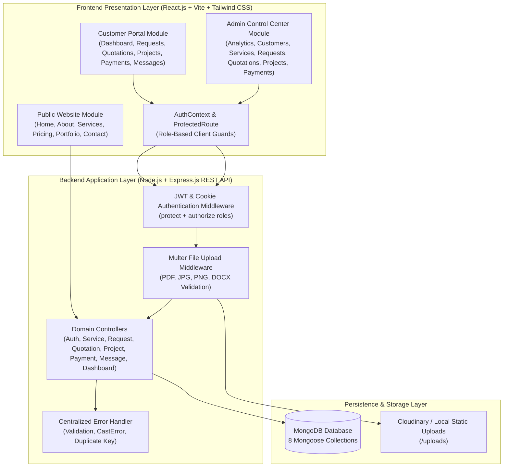

# Dynamic IT — System Architecture & Security Specification

## 1. High-Level System Architecture Diagram

---

## 2. Technology Stack Justification (For Viva Defense)

1. **React.js + Vite (JavaScript)**:
   - Component-based architecture allows clean reuse across the Public Website, Customer Dashboard, and Admin Control Center (`StatusBadge`, `ProgressBar`, `DashboardLayout`, `EmptyState`).
   - Vite provides instant HMR in development and optimized static asset bundling in production.
2. **Tailwind CSS**:
   - Enables a cohesive design system (`brand` indigo palette, consistent spacing, responsive grid layouts across mobile, tablet, and desktop).
3. **Node.js + Express.js REST API**:
   - Non-blocking I/O handles concurrent client dashboard polling, file uploads, and database queries efficiently.
   - Modular controller-service-route separation keeps business logic clean and testable.
4. **MongoDB + Mongoose ODM**:
   - Ideal for evolving agency service features, embedded project milestones, and relational document references (`ObjectId` population across `User`, `Service`, `ServiceRequest`, `Quotation`, `Project`, `Payment`, and `Message`).

---

## 3. Ten Core Security Controls Implemented

1. **Password Hashing**: Passwords are encrypted using `bcryptjs` (10 salt rounds) inside the `User` Mongoose `pre('save')` hook and excluded from queries by default (`select: false`).
2. **HTTP-Only Cookie + JWT Authentication**: Tokens are stored in `httpOnly` cookies to mitigate XSS token theft while also supporting Bearer tokens for API clients.
3. **Strict Role Assignment on Registration**: `POST /api/auth/register` hardcodes `role: 'customer'`, making privilege escalation via public registration impossible.
4. **Role-Based Access Control (`authorize`)**: Admin-only routes (`/api/customers`, `POST /api/quotations`, `POST /api/projects`, `POST /api/payments`, etc.) strictly verify `req.user.role === 'admin'`.
5. **Ownership Validation**: Customers can only view or act upon their own `ServiceRequest`, `Quotation`, `Project`, `Payment`, and `Message` documents (`doc.customer.toString() === req.user._id.toString()`).
6. **Immutable Quotation Amount for Customers**: `PATCH /api/quotations/:id/respond` rejects any attempt by a customer to alter the proposed quotation amount.
7. **Quotation Expiry Enforcement**: Expired quotations (`validUntil < now`) are automatically transitioned to `'expired'` and cannot be accepted.
8. **Duplicate Project Prevention**: `Project.quotation` has a unique index and controller check preventing multiple projects from being created from the same accepted quotation.
9. **Server-Side File Upload Validation**: Multer validates both MIME type and file extension (`.pdf`, `.jpg`, `.jpeg`, `.png`, `.docx`) and enforces an 8MB file size limit.
10. **Centralized Error Sanitization**: `errorMiddleware.js` translates Mongoose `ValidationError`, `CastError`, and duplicate key (`11000`) errors into safe, human-readable HTTP 400 responses without leaking stack traces in production.
